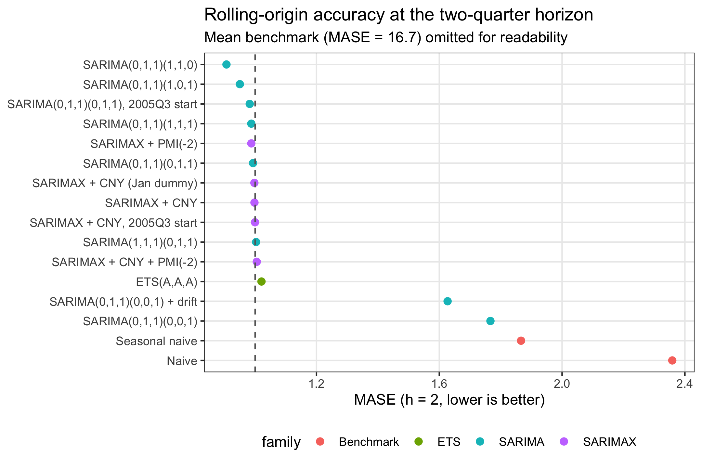
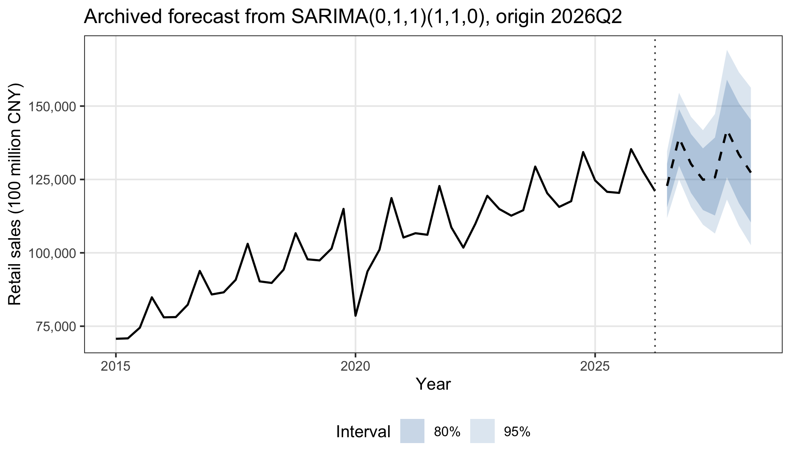

# Forecasting China's Quarterly Retail Sales

**Does a lunar New Year adjustment help two-quarter-ahead forecasts?**

STA4003 Time Series Analysis · 2026 Fall · Group 12

---

## Overview

This project builds a reproducible forecasting pipeline for China's quarterly total
retail sales of consumer goods and uses it to answer a single empirical question:
**does explicitly modelling the moving lunar New Year (CNY) improve out-of-sample
accuracy relative to a standard seasonal model?**

The answer is no — and the project's main contribution is not the forecast itself but
the *evaluation design* that makes that conclusion credible: 17 competing models
compared over 56 rolling origins, with point accuracy, probabilistic accuracy and
statistical significance all assessed out of sample.

Three deliverables trace the project from proposal to final report, and each stage's
code is kept in its own folder.

## Headline results

| Item | Result |
|---|---|
| Sample | 130 quarters, 1994Q1–2026Q2 (NBS national total retail sales) |
| Models compared | 17: 3 benchmarks, 7 SARIMA, 6 dynamic regressions, 1 damped ETS |
| Evaluation | Expanding-window rolling origin, 2012Q1–2025Q4 (56 origins), h = 1 and h = 2 |
| Selected model | SARIMA(0,1,1)(1,1,0)[4] on log retail sales |
| Two-step MASE | **0.907** vs **1.866** for seasonal naive (≈ 51% lower) |
| Diebold–Mariano vs seasonal naive | h = 1: p = 0.015 (significant); h = 2: p = 0.097 (not significant) |
| CNY / PMI covariates | No reliable two-step gain, including under matched-control windows |
| Forecast 2026Q3 | **122,810** (80% interval 115,469–130,327), 100 million CNY |
| Forecast 2026Q4 | **139,192** (80% interval 129,680–148,964), 100 million CNY |



*Two-step MASE across all 17 models at the 56 common origins. The mean benchmark is
omitted from the plot because its MASE is an order of magnitude larger.*



*Final forecasts from the 2026Q2 origin with 80% and 95% prediction intervals.*

## Findings in one paragraph

A parsimonious seasonal ARIMA with a single non-seasonal MA term and a single seasonal
AR term forecasts better than the seasonal naive benchmark at the two-quarter horizon.
The advantage is statistically significant one quarter ahead but not two, which is the
honest reading of a 56-origin evaluation rather than an artefact of in-sample fit.
Adding a lunar New Year regressor, a PMI leading indicator, or both does not improve
two-step accuracy, even when the covariate models are compared against controls fitted
on the identical 2005Q3-start window. Informally, CNY shifts sales *within* Q1 (between
January and February) but leaves the Q1 total roughly unchanged, so at quarterly
resolution there is little for the covariate to explain. Model selection by AICc and
selection by out-of-sample MASE do not agree, which is itself a result worth reporting.

## Repository structure

```
.
├── proposal/                     Stage 1: research proposal
│   ├── Proposal_gp12_final_v.pdf
│   ├── build_proposal.py         DOCX/PDF builder
│   ├── fetch_nbs_data.py         NBS data downloader
│   ├── build_quarterly.py        monthly -> quarterly aggregation
│   ├── plot_figure1.py           proposal figure
│   ├── Figure1.png
│   └── data/raw/                 raw NBS monthly series (CSV)
│
├── interim/                      Stage 2: interim report
│   ├── InterimReport_gp12.pdf
│   ├── build_interim.py          report builder
│   └── R/                        EDA, stationarity, CNY analysis, preliminary models
│
└── final/                        Stage 3: final analysis and report
    ├── FinalReport_gp12_v4.docx  final manuscript
    ├── README.md                 detailed reproduction notes
    ├── Project_Explained_From_Scratch.md   from-zero Chinese walkthrough
    ├── R/                        analysis pipeline (entry point: R/run_all.R)
    ├── tests/                    independent checks on computed outputs
    ├── scripts/                  summary, clean-run verifier, packaging, slides
    ├── build_final_report.py     builds the Word report from R output
    ├── make_equations.py         renders report equations
    ├── data/                     raw, processed and calendar data (CSV)
    ├── reference/                archived 13 Nov run (provenance) + Q3 releases
    └── output/                   figures, tables, verification receipts
```

## Data

Source: National Bureau of Statistics of China (NBS), National Data platform
(`data.stats.gov.cn`), national aggregate, retrieved 28 September 2026.

- **Retail sales**: monthly current-month and cumulative vintages, 1994–2026.
- **Quarterly construction**: since 2012 the NBS publishes January and February only as
  a combined Jan–Feb total, so Q1 = published Jan–Feb total + March, while Q2–Q4 are
  recovered by differencing the official cumulative series. The reconstructed series
  reproduces the published annual totals exactly over 2000–2025
  (see `final/data/processed/VERIFICATION.txt`).
- **Manufacturing PMI**: quarterly, 2005Q1–2026Q2 (N = 86), used as a candidate leading
  indicator with a two-quarter lag.
- **Lunar New Year dates**: 1994–2026, computed from the lunar calendar and checked
  against official holiday schedules.

Units are 100 million CNY (亿元) throughout unless trillion CNY is stated explicitly.

## Method summary

1. **Transformation** — natural log of quarterly retail sales, to stabilise variance
   and make multiplicative growth approximately linear.
2. **Stationarity** — joint ADF (H0: unit root) and KPSS (H0: stationarity) testing
   over candidate difference orders; d = 1, D = 1 selected and cross-checked against
   the ACF of each candidate transform.
3. **Candidate set** — 17 models: mean, naive and seasonal naive benchmarks; seven
   SARIMA specifications; six dynamic regressions with CNY and/or lagged PMI, including
   matched-control arms that start in 2005Q3; and a damped ETS(A,A,A).
4. **Evaluation** — expanding-window rolling origin from 2012Q1 to 2025Q4 (56 origins)
   at horizons 1 and 2, with a fixed information set at every origin, scored by MAE,
   RMSE and MASE using a training-derived seasonal-naive scale shared by all models.
5. **Inference** — Diebold–Mariano tests on loss differentials for the headline
   comparisons.
6. **Uncertainty** — point forecasts are bias-adjusted log-normal means; intervals are
   log-normal prediction intervals, assessed by empirical coverage, mean width and
   Winkler score.
7. **Robustness** — pre/post-2020 subsamples, COVID-target exclusion, rolling error
   paths, forecast combination and a walk-forward selector.

## Reproduce

Requires R 4.5+ with `forecast`, `tseries`, `ggplot2`, `lmtest`, `zoo`, `scales`,
`cowplot`, `dplyr`, `tidyr`, and Python 3.13 with `python-docx` and `matplotlib`.

```bash
cd final

# 1. Optional: re-download the raw NBS files (needs internet)
python3 fetch_nbs_data.py

# 2. Rebuild the quarterly series and its verification report
python3 build_quarterly.py

# 3. Full analysis: EDA, stationarity, models, rolling-origin evaluation,
#    diagnostics, final forecasts, robustness, interval scoring
Rscript --vanilla R/run_all.R

# 4. Independent checks
Rscript tests/test_outputs.R
Rscript tests/test_optimization.R
python3 scripts/summarize_results.py

# 5. Rebuild the report
python3 make_equations.py
python3 build_final_report.py
```

`Rscript R/run_all.R` writes every figure and table to `final/output/`, so the numbers
in the report are generated from code rather than typed by hand.

## Reports

| Stage | File |
|---|---|
| Proposal | [`proposal/Proposal_gp12_final_v.pdf`](proposal/Proposal_gp12_final_v.pdf) |
| Interim report | [`interim/InterimReport_gp12.pdf`](interim/InterimReport_gp12.pdf) |
| Final report | [`final/FinalReport_gp12_v4.docx`](final/FinalReport_gp12_v4.docx) |

The final report is an editable Word document with native equations. The group roster
appears on its title page.

## Notes on scope and honesty

- The candidate model set was extended after the first rolling results had been
  inspected, so cross-model comparisons are descriptive rather than adjusted inference.
  This is stated in the report.
- Supplementary analyses (Q1 subgroup, pre/post-2020 splits, pandemic-target exclusion,
  forecast combination, walk-forward selection) were designed after seeing the original
  results and are reported as such; they are not independent validation.
- The 2026Q3 actual is computed from two NBS cumulative releases and never enters any
  model. The archived November run under `final/reference/` is kept for provenance, and
  `final/output/tables/tab_final_forecast_reconciliation.csv` records archived-versus-
  rerun differences row by row.

## Course context

This is the final project for **STA4003 Time Series Analysis** (2026 Fall). It is
published for reference and portfolio purposes; the code is not licensed for reuse as
coursework by others.
